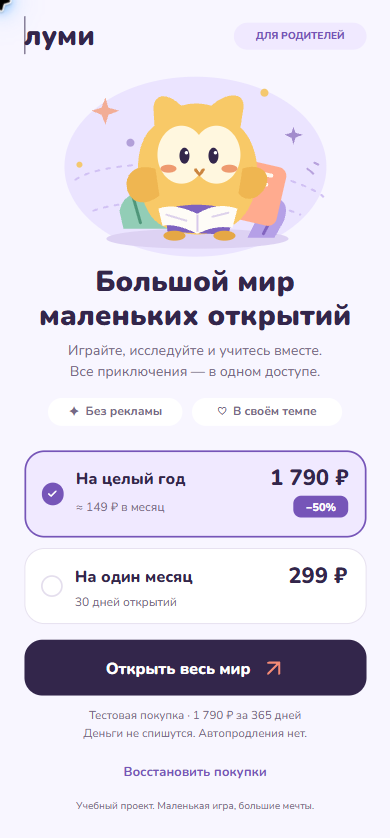

# Луми · маленькие открытия

Мобильный paywall вымышленной детской игры на **Nuxt 4 + TypeScript**: два тарифа, тестовая покупка и восстановление доступа. Деньги не списываются, автопродления нет.

**[Открыть приложение](https://lumi-paywall.vercel.app)** · **[Макет в Figma](https://www.figma.com/design/UXGo2MuLLvDZEtRs3Giisd?node-id=2-2)**

[](https://github.com/Echi4ok/lumi-paywall/actions/workflows/ci.yml)



## Запуск

Node **22.23.3** (`.nvmrc`), npm. Аккаунты и ключи не нужны:

```sh
npm ci
npm run dev
```

Приложение доступно на `http://127.0.0.1:3000`. Локальная PostgreSQL-совместимая PGlite создаёт БД в `.data/lumi`.

## Устройство проекта

| Путь                                    | Ответственность                      |
| --------------------------------------- | ------------------------------------ |
| `app/features/paywall/`                 | Экран, состояние и HTTP-клиент       |
| `app/ui/`, `app/assets/css/`            | UI-примитивы, токены и базовые стили |
| `shared/contracts/`                     | Контракт API                         |
| `server/api/`, `server/http/`           | Маршруты, валидация и cookie         |
| `server/application/`, `server/domain/` | Сценарии и правила покупки           |
| `server/infrastructure/`, `migrations/` | Работа с БД и схема                  |

**Vercel + Neon PostgreSQL**: Nuxt server routes и frontend развёрнуты вместе; покупки сохраняются во внешней БД между деплоями. Сервер определяет цену, а ключ попытки предотвращает повторную покупку при потере ответа. Для облачной БД нужны `DATABASE_URL`, `RATE_LIMIT_SECRET` и миграции — см. [запуск и деплой](docs/OPERATIONS.md). Решения, контракт API и ограничения описаны в [архитектуре](docs/ARCHITECTURE.md).

## Проверка и AI

`npm run check` проверяет форматирование, запускает ESLint, TypeScript, модульные, SQL-интеграционные и компонентные тесты. CI дополнительно проверяет production-сборку с PostgreSQL 16, HTTP-сценарии и Chromium/WebKit. [Команды полной проверки](docs/OPERATIONS.md#проверка).

**OpenAI Codex** частично использован для макета, реализации и проверки кода, человек вводил правки, проводил ревью. Автоматизированные проверки дополнены проверкой интерфейса через браузер и сравнением с Figma. [Макет и визуальное сравнение](design/README.md).

**Следующие 2 часа:** проверка на физических WKWebView/Android WebView и уточнение рендера по макету. Дополнительные сценарии восстановления и проверки расширили работу сверх двухчасового ориентира ТЗ.
