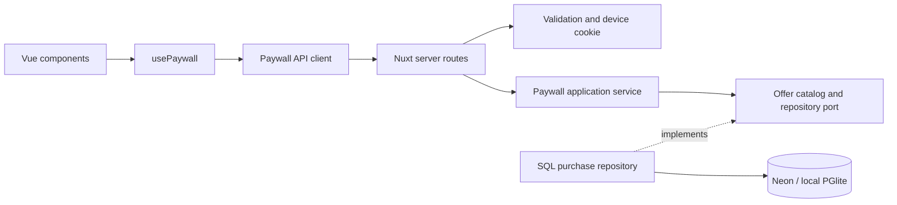

# Архитектура

Один экран не требует микросервисов, DI-контейнера или глобального store. Разделены четыре причины для изменений: отображение, HTTP, правила покупки, хранение данных.

`server/infrastructure/services.ts` связывает зависимости. Application получает репозиторий, часы и генератор ID явно: тесты могут управлять временем, не подменяя Nuxt или SQL. Domain не знает HTTP и драйвер БД. Shared содержит только публичный контракт, не серверные секреты и не доступ к БД.

## Покупка и повтор запроса

Клиент отправляет `offerId` и UUID попытки. Сервер сам находит цену и продолжительность в каталоге. Покупка хранит снимок цены, валюту, устройство, время и конец доступа. Тарифы фиксированные: 30 и 365 дней; автопродления нет.

Ограничение `UNIQUE(device_id, request_id)` обеспечивает идемпотентность на уровне БД. `INSERT ... ON CONFLICT ... RETURNING` атомарно возвращает первоначальный результат, в том числе при конкурентных запросах. Повтор ключа с другим тарифом возвращает `409`, а не меняет покупку. Клиент сохраняет ключ при сетевой ошибке.

Восстановление читает активную покупку этого устройства с наиболее поздним окончанием доступа. Это анонимный демо-сценарий: cookie — случайный непрогнозируемый идентификатор, не система пользовательских аккаунтов. Его потеря означает потерю возможности сопоставить устройство с покупкой.

## Границы доверия

- Браузер не назначает цену, дату, устройство или срок доступа.
- Вход строго валидируется; неизвестные поля и слишком большой JSON отклоняются.
- HttpOnly/SameSite cookie, проверка Origin и Fetch Metadata защищают браузерные запросы от межсайтовой отправки.
- SQL параметризован. Ответы API не раскрывают строку подключения и внутренние ошибки.
- API не кешируется. Личные квитанции не попадают в общую HTML-страницу или CDN-кеш.
- Production без `DATABASE_URL` не создаёт файловую БД на эфемерном диске.

## Осознанные упрощения

Каталог из двух тарифов хранится в коде, поэтому не нужны таблица офферов и админка. SQL без ORM достаточен для одной таблицы; один repository port позволяет проверить тот же запрос в PGlite и Neon. Локальная и облачная БД используют одну схему. Миграция запускается отдельно от запросов production.

Нет авторизации, настоящей платёжной интеграции, фоновых очередей, webview bridge или выдуманной игровой механики. Каждая кнопка относится к проверяемому сценарию задания.
