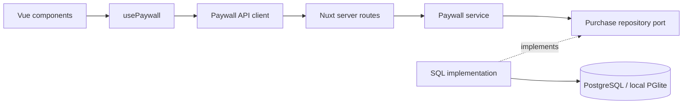

# Архитектура

Приложение объединяет Vue-экран и Nuxt server routes. `usePaywall` управляет покупкой, восстановлением и отменой запросов; HTTP-клиент — дедлайном и ошибками. В `app/ui/` находятся кнопка, индикатор и сообщение, в `app/assets/css/` — общие токены. Компоненты тарифов и их стили остаются в `features/paywall`.

`server/infrastructure/services.ts` собирает зависимости. Сервис получает репозиторий, часы и генератор ID: тесты управляют временем без подмены Nuxt. Domain содержит каталог и контракт репозитория; `shared/contracts/paywall.ts` — публичные типы запросов и ответов.

## API

| Метод и путь         | Вход                                                                        | Успешный ответ, HTTP 200                                                                   |
| -------------------- | --------------------------------------------------------------------------- | ------------------------------------------------------------------------------------------ |
| `GET /api/offers`    | Cookie `lumi_device`; при её отсутствии заголовок `X-Lumi-Bootstrap` с UUID | `{ offers: Offer[] }`; при bootstrap устанавливает cookie                                  |
| `POST /api/purchase` | Cookie и JSON `{ offerId: 'monthly' \| 'yearly', requestId: UUID }`         | `{ purchase: PurchaseReceipt, replayed: boolean, active: boolean }`                        |
| `POST /api/restore`  | Cookie, тело не требуется                                                   | `{ purchase: PurchaseReceipt \| null }`; без cookie или активной покупки возвращает `null` |
| `GET /api/health`    | Без параметров                                                              | `{ status: 'ok' }`, если конфигурация и БД доступны                                        |

Квитанция содержит `id`, `requestId`, `offerId`, `purchasedAt`, `expiresAt`. Ошибки передают `data.code` и `data.message`: `400` — неверный ввод/bootstrap, `401` — покупка без сессии, `403` — запрещённый origin, `409` — ключ попытки уже связан с другим тарифом, `413/415` — размер/формат тела, `429` — лимит, `503` — недоступность сервиса. JSON покупки ограничен 1 КиБ; лишние поля отклоняются. POST проверяют Origin/Fetch Metadata. Все ответы API имеют `Cache-Control: private, no-store` и `X-Request-Id`.

## Покупки и хранение

Сервер определяет цену и срок по каталогу: 30 или 365 дней. БД сохраняет их вместе с устройством и временем покупки. `UNIQUE(device_id, request_id)` и атомарный `INSERT ... ON CONFLICT` возвращают исходную покупку при повторе; другой тариф с тем же ключом даёт конфликт. Клиент сохраняет ключ после сетевой ошибки. Сервер вычисляет `active`, поэтому повтор истёкшей покупки не открывает доступ заново.

Restore выбирает активную покупку с наиболее поздним окончанием доступа и работает без загрузки каталога. По `requestId` квитанции клиент завершает только соответствующую незавершённую попытку.

Для первых вкладок IndexedDB одной транзакцией создаёт общий UUID. Клиент передаёт его при загрузке каталога, сервер устанавливает HttpOnly/SameSite cookie; существующая cookie имеет приоритет. При недоступной IndexedDB существующая cookie продолжает работать, новый профиль получает сообщение об ошибке.

Схема состоит из трёх таблиц: `purchases`, `rate_limit_buckets`, `schema_migrations`. Каталог из двух тарифов хранится в коде. Параметризованный SQL выполняется через Neon HTTP, `pg.Pool` для обычного PostgreSQL или локальный PGlite. Production требует внешнюю БД. Миграции имеют порядок и checksum, выполняются транзакционно под advisory lock; инструкции — в [OPERATIONS.md](OPERATIONS.md).

Общие лимиты запросов хранятся в БД и проверяются по операции, IP и устройству. Идентификаторы buckets хешируются HMAC с общим секретом; устаревшие записи удаляются порциями. Это ограничивает частоту запросов, но нагружает ту же БД; при росте нагрузки limiter следует переносить на входной прокси или отдельное хранилище.

## Ограничения

- Покупки тестовые: настоящих платежей, автопродления и проверки store receipts нет.
- Browser identity — анонимный bearer-идентификатор. UUID доступен JavaScript в IndexedDB, поэтому HttpOnly cookie не защищает эту модель от XSS. Очистка данных сайта или другой браузер теряют связь с покупками; у старого профиля без IDB-bootstrap её может потерять и удаление одной cookie.
- Физические WKWebView/Android WebView не проверены. Браузерные тесты запускаются в Chromium и desktop WebKit с мобильным viewport.
- Строгие **99% Pixel Perfect не подтверждены**. Методика, результат сравнения и исходные изображения — в [design/README.md](../design/README.md).
- `npm audit` на 13 октября 2026 года: 0 critical, 11 high через tooling-зависимости [braces](https://github.com/advisories/GHSA-vfj7-8cjw-p6xm) и [node-forge](https://github.com/advisories/GHSA-86w9-cpqp-85rv). Эти пакеты не перечислены в manifest собранного Nitro; перед дальнейшим использованием нужны повторный audit и проверка обновлений.
- Production backups/restore и RPO/RTO не подтверждены. CI проверяет восстановление тестового дампа. Внешние uptime monitor и alerting не настроены.
