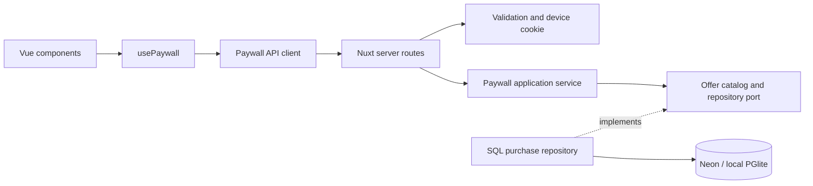

# Архитектура

Один экран не требует микросервисов, DI-контейнера или глобального store. Разделены четыре причины для изменений: отображение, HTTP, правила покупки, хранение данных.

`server/infrastructure/services.ts` связывает зависимости. Application получает репозиторий, часы и генератор ID явно: тесты могут управлять временем, не подменяя Nuxt или SQL. Domain не знает HTTP и драйвер БД. Shared содержит только публичный контракт, не серверные секреты и не доступ к БД.

`app/ui/` содержит переиспользуемые кнопку, индикатор и сообщение без знания тарифов или API. Токены и базовые стили находятся в `app/assets/css/`; стили экрана принадлежат компонентам feature. `usePaywall` управляет сценариями и отменой запросов, транспорт — дедлайном и нормализацией ошибок. Компоненты не обращаются к серверным модулям. Отдельный npm-пакет или Storybook для трёх примитивов пока не нужны.

## Покупка и повтор запроса

Клиент отправляет `offerId` и UUID попытки. Сервер сам находит цену и продолжительность в каталоге. Покупка хранит снимок цены, валюту, устройство, время и конец доступа. Тарифы фиксированные: 30 и 365 дней; автопродления нет.

Ограничение `UNIQUE(device_id, request_id)` обеспечивает идемпотентность на уровне БД. `INSERT ... ON CONFLICT ... RETURNING` атомарно возвращает первоначальный результат, в том числе при конкурентных запросах. Повтор ключа с другим тарифом возвращает `409`, а не меняет покупку. Клиент сохраняет ключ при сетевой ошибке.

Восстановление читает активную покупку этого устройства с наиболее поздним окончанием доступа. Квитанция содержит исходный `requestId`: клиент завершает только совпадающую незавершённую попытку. Сервер вычисляет `active` по своим часам. Повтор давно истёкшей покупки возвращает прежнюю квитанцию с `active: false`; интерфейс предлагает новую покупку отдельным нажатием. Восстановление не зависит от доступности каталога.

При первом открытии IndexedDB одной транзакцией выбирает криптографический UUID для всех вкладок этого origin. Клиент передаёт его только при загрузке каталога; сервер отдаёт HttpOnly cookie. Существующая валидная cookie имеет приоритет. Поэтому два первых параллельных ответа не подменяют друг другу устройство. Если хранилище недоступно, работает существующая cookie; для нового профиля выводится объяснение, случайный запасной UUID не создаётся.

Это анонимный bearer-идентификатор учебного приложения, не авторизация. Его копия в IndexedDB доступна JavaScript того же origin: HttpOnly не защищает эту модель от XSS. Очистка всех данных сайта или другой браузер теряют связь с покупками. В старом профиле, созданном до IndexedDB bootstrap, удаление одной cookie тоже может потерять связь; универсальное восстановление без аккаунта не обещается.

## Границы доверия

- Браузер не назначает цену, дату или срок доступа. Purchase/restore определяют устройство исключительно по cookie.
- Вход строго валидируется; неизвестные поля и слишком большой JSON отклоняются.
- HttpOnly/SameSite cookie, проверка Origin и Fetch Metadata защищают браузерные запросы от межсайтовой отправки.
- SQL параметризован. Ответы API не раскрывают строку подключения и внутренние ошибки.
- API не кешируется. Личные квитанции не попадают в общую HTML-страницу или CDN-кеш.
- Production без `DATABASE_URL` не создаёт файловую БД на эфемерном диске.

## Нагрузка и эксплуатация

Распределённый limiter использует PostgreSQL: один атомарный запрос проверяет общий лимит операции, затем IP и устройство. После отказа на общем уровне произвольные UUID не создают новые строки. Старые buckets удаляются ограниченными порциями. Время окна берётся из БД; IP и UUID хранятся как HMAC с общим `RATE_LIMIT_SECRET`. На Vercel доверяется только платформенный заголовок; при самостоятельном размещении — адресу сокета. Это ограничение частоты учебного API, не защита от volumetric DDoS; при масштабировании лимиты должны переехать на ingress/Redis, чтобы отказ не нагружал основную БД.

Внешний SQL-адаптер выбирается явно: Neon HTTP либо стандартный `pg.Pool`. Последний используется в CI с PostgreSQL 16. Миграции выполняются транзакционно под advisory lock, имеют порядок и SHA-256 в `schema_migrations`. Изменение применённого файла и неизвестная история отклоняются. Runtime проверяет ожидаемую схему; `/api/health` проверяет БД и конфигурацию, не раскрывая детали. Для ошибок сохраняются request ID, операция и безопасная категория; значения SQL, cookie и строка подключения не логируются. Процедуры выпуска, восстановления и диагностики — в [OPERATIONS.md](OPERATIONS.md).

## Осознанные упрощения

Каталог из двух тарифов хранится в коде, поэтому не нужны таблица офферов и админка. SQL без ORM достаточен для одной таблицы; один repository port позволяет проверить тот же запрос в PGlite и Neon. Локальная и облачная БД используют одну схему. Миграция запускается отдельно от запросов production.

Нет авторизации, настоящей платёжной интеграции, фоновых очередей, webview bridge или выдуманной игровой механики. Каждая кнопка относится к проверяемому сценарию задания.
